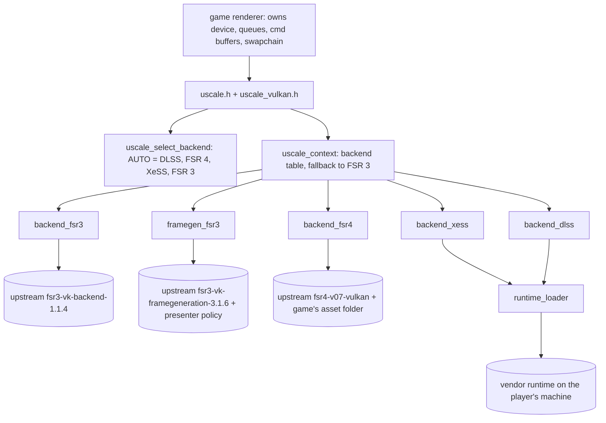

# FSR-Vulkan code map

- **Repo:** iannitram/FSR-Vulkan (public fork). **Kind:** fork built our way: our shared upscaler and frame-generation library (`uscale`) for the `-universal` games, a C11 library built with CMake on top of upstream's portable Vulkan scalers.
- **Upstream:** FireBurn/UniversalScalers-Vulkan (formerly FireBurn/FSR-Vulkan), `upstream/main`, synced daily. **Integration branch:** `main`.
- **Describes:** main after the Roadmap commit of 2026-11-02 (upstream at `69fecd7`).

The game owns the Vulkan instance, device, queues, command buffers, swapchain and images. `uscale` picks a backend, records upscaling and frame-generation work into the game's command buffer, and never submits or presents. How FSR 4, XeSS and DLSS reach the GPU: `docs/adr/0001-vendor-paths.md`.

## Ours: `universal/` (the uscale library)

Status: **present** = built and tested; **stub** = file exists, returns `USCALE_ERROR_NOT_IMPLEMENTED`; **planned** = no file yet. An issue that builds a module moves its status in the same PR.

| Path | What it owns | Status | Roadmap |
|---|---|---|---|
| `universal/CMakeLists.txt` | Targets `uscale_core` (`uscale::core`, pure half), `uscale_vulkan` (`uscale::uscale`, Vulkan half); options `USCALE_BUILD_TESTS`, `USCALE_WITH_VULKAN` (on when Vulkan is found), `USCALE_WITH_FFX` (off; requires Vulkan, adds upstream with `EXCLUDE_FROM_ALL` and links only FSR 3, frame generation, presenter policy and FSR 4 v07); shares one upstream tree with `USCALE_TEST_FSR3_FRAMEGEN`; our lint (warnings are errors); every `tests/*_test.c` becomes a CTest test; install and package export rules (`uscaleConfig.cmake`, `uscaleTargets.cmake`) | present | 1, 2.05, 6.02 |
| `universal/include/uscale.h` | Pure API: version macros, `uscale_result`, `uscale_backend`, `uscale_quality`, `uscale_extent`, `uscale_device_caps`, profiling flag bits; `uscale_version`, `uscale_result_name`, `uscale_backend_name`, `uscale_render_extent`, `uscale_select_backend`, `uscale_profile_flags_from_env` | present | 1 |
| `universal/include/uscale_vulkan.h` | Vulkan API: `uscale_image`, `uscale_context_create_info`, `uscale_upscale_info`, `uscale_framegen_info`; `uscale_query_caps`, `uscale_context_create`, `uscale_context_backend`, `uscale_record_upscale`, `uscale_record_framegen`, `uscale_retire_frame`, `uscale_context_destroy` | present | 1 |
| `universal/src/uscale_version.c` | `uscale_version` | present | 1 |
| `universal/src/uscale_names.c` | `uscale_result_name`, `uscale_backend_name` | present | 2.01 |
| `universal/src/uscale_render_extent.c` | `uscale_render_extent` | present | 2.02 |
| `universal/src/uscale_select.c` | `uscale_select_backend` | present | 2.03 |
| `universal/src/uscale_profile.c` | `uscale_profile_flags_from_env` | present | 2.04 |
| `universal/src/uscale_caps.c` | `uscale_query_caps`: vendor, integer dot product, FP16, MoltenVK, FSR 4 assets (vendor runtimes stay 0 until 5.04, 5.06) | present | 3.01, 5.04, 5.06 |
| `universal/src/uscale_context.c` | Context lifecycle; picks the backend with `uscale_select_backend`, falls back to FSR 3 if a backend's create fails; routes record calls | present | 3.02 |
| `universal/src/backend.h` | Internal backend table `uscale_backend_ops` (create, record_upscale, destroy) and the frame-generation calls | present | 1 |
| `universal/src/backend_fsr3.c`, `.h` | Pure `uscale_fsr3_map_dispatch` to upstream's `FfxVkPortableUpscaleDispatchInfo`: image metadata/layout states, unchanged render-pixel jitter, normalized UV motion scaled by active render size, milliseconds, camera, sharpness, reset and caller frame id; neutral exposure/metre defaults and absent masks; field tests run with Vulkan headers even when FFX is off. GPU lifecycle through `ffx-vulkan::fsr3-vk-backend-1.1.4` remains stubbed | present (mapping); stub (GPU) | 3.03, 3.04, #11 |
| `universal/src/framegen_fsr3.c` | Frame generation through `ffx-vulkan::fsr3-vk-framegeneration-3.1.6` and `ffx-vulkan::framegeneration-presenter-policy` | stub | 3.05 |
| `universal/src/backend_fsr4.c` | FSR 4 through `ffx-vulkan::fsr4-v07-vulkan` and `ffx-vulkan::fsr4-v07-assets`, assets from `fsr4_asset_dir` | stub | 5.03 |
| `universal/src/runtime_loader.c`, `.h` | Opens the first vendor runtime from a name list (`dlopen`, `LoadLibrary`), reports load status, resolves symbols and closes it | present | 5.02 |
| `universal/src/backend_xess.c` | XeSS through Intel's runtime | stub | 5.05 |
| `universal/src/backend_dlss.c` | DLSS through NVIDIA's runtime (NGX Vulkan) | stub | 5.07 |
| `universal/tests/uscale_test.h` | Test harness: `CHECK`, `CHECK_INT`, `CHECK_STR`, `USCALE_TEST_END` | present | 1 |
| `universal/tests/uscale_*_test.c` | Pure tests, run on every platform | present (version) | 2.x |
| `universal/tests/uscale_vk_*_test.c` | Tests that need the Vulkan half (built only with `USCALE_WITH_VULKAN`) | present (link, device) | 2.06, 3.x, 5.x |
| `universal/tests/uscale_vk_device_test.c` | Creates an instance, device and queue; CTest skips with code 77 when no device is available, unless `USCALE_REQUIRE_VK_DEVICE=1` | present | 2.06 (#8) |
| `universal/tests/uscale_vk_framegen_retire_test.cpp` | Opt-in FSR 3.1.6 GPU regression: 1,003 generated frames, bounded live memory and descriptor pools, reserved frame id 0 refused; enable `USCALE_TEST_FSR3_FRAMEGEN` ([run and measurements](framegen-retire.md)) | present | #28 |
| `universal/cmake/uscaleConfig.cmake.in` | CMake package configuration template for `find_package(uscale CONFIG REQUIRED)`, exports `uscale::uscale` and `uscale::core` aliases and finds dependencies | present | 6.02 |
| `universal/scripts/uscale_install_check.py` | Install tree verification script: fails if install tree contains NVIDIA, AMD, Intel binaries or model files (SPEC M12); `--test-planted` verifies planted file failure | present | 6.02 |
| `universal/tests/consumer/` | Tiny consumer smoke project: finds `uscale` via `find_package(uscale CONFIG REQUIRED)` and links `uscale::uscale` | present | 6.02 |
| `universal/examples/minimal/` | The example consumer from the integration guide | planned | 6.01 |
| `docs/integration.md` | How a `-universal` game adds and calls `uscale` | planned | 6.01 |
| `docs/licences.md` | What each vendor path lets us ship | stub | 5.01 |
| `.github/workflows/fork-ci.yml` | Our CI: `universal/` on Ubuntu, Windows and macOS, plus `USCALE_WITH_FFX=ON` on Ubuntu; Linux installs Mesa and pins lavapipe, requires device tests to run; tests `cmake --install`, downstream consumer project build and `uscale_install_check` (clean and planted fail) on all platforms; checks no recovered pipeline file was built | present | 1, 2.05, 2.06, 4.01, 4.02, 6.02 |

### How it fits together



- `USCALE_WITH_FFX=ON` adds the repo root with `EXCLUDE_FROM_ALL` (upstream tests off) and links only the upstream targets in the diagram, so `xess-recovered`, `dlss-contract` and the d4r shaders are never compiled (ruling of 2026-11-01).
- Lifecycle: `uscale_query_caps -> uscale_context_create -> (per frame) uscale_record_upscale [-> uscale_record_framegen] -> uscale_retire_frame after the game's fence -> uscale_context_destroy`.

## Upstream's tree (read, link, do not edit)

| Path | What it owns | We use it |
|---|---|---|
| `CMakeLists.txt` | All upstream targets (`ffx-vulkan::<name>`), options `FFX_VK_PORTABLE_BUILD_*`, install and package export | through `USCALE_WITH_FFX` |
| `include/ffx_vk_portable.h`, `src/ffx_vk_portable.c`, `src/ffx_vk_fsr3_portable.cpp` | Core C contract, capability probe, FSR 3.1.4 host glue | yes |
| `include/`, `src/ffx_vk_fsr3_3_1_5_*` | SDK 2.3 FSR 3.1.5 upscaler (bridge, bundle, catalog, descriptor, pipeline, reflection) | yes |
| `src/ffx_vk_fsr3_3_1_6_framegen*.cpp` | FSR 3.1.6 optical flow and frame interpolation | yes |
| `include/ffx_vk_framegeneration_presenter.h`, `src/ffx_vk_framegeneration_presenter.c` | Present-plan policy for generated-then-real frames; no swapchain ownership | yes |
| `src/ffx_vk_fsr4_v07*.c`, `include/ffx_vk_fsr4_v07*.h` | FSR 4 v07 provider, asset helper, schedule (includes the 4.1.2 schedule) | yes, with game-supplied v07 assets only |
| `include/ffx_vk_unified_sr.h`, `src/ffx_vk_unified_sr.c`, `include/ffx_vk_all_scalers.h`, `ffx_vk_scaler_catalog.h` | Upstream's own umbrella API and catalog; routes to the recovered paths | no (ADR 0001) |
| `src/ffx_vk_xess_*`, `include/ffx_vk_xess_*`, `examples/xess-recovered/`, `shaders/xess/` | Recovered XeSS 2.0.2 pipeline and contract | never built (ruling 2026-11-01) |
| `src/ffx_vk_dlss_contract.c`, `include/ffx_vk_dlss_contract.h`, `include/d4r_*_spv.h`, `shaders/dlss/` | Recovered DLSS / d4r pipeline | never built (ruling 2026-11-01) |
| `tools/extract_fsr412_vk.py`, `tools/ffx_dxil/`, `tools/generate_dlss_shaders.py` | Model extraction and recovered-shader tools | never run (ruling 2026-11-01) |
| `src/ffx_vk_*_contract.c` (ray regeneration, radiance cache, ML frame generation), `src/ffx_vk_temporal_lifecycle.c` | Input validators | no (a Won't) |
| `upstream/ffx-1.1.4/`, `upstream/ffx-2.3.0/`, `generated/` | Vendored AMD FidelityFX sources (MIT per file) and checked-in SPIR-V tables | through the FSR targets |
| `tests/`, `examples/`, `tools/` (others) | Upstream's tests, examples, generators | upstream's |
| `README.md`, `INTEGRATION_GUIDE.md`, `UPSTREAM.md`, `NOTICE.md`, `PUBLISHING.md`, `LICENSE.txt`, `.github/workflows/ci.yml` | Upstream's docs, licence and CI | read only |

## Where our work is

`git log upstream/main..main`. Our only edits to upstream-owned files are the FSR 4 profiling switches (D1) and the fixes below:

| Commit | Files | Change |
|---|---|---|
| `cc76692` | `src/ffx_vk_fsr4_v07.c` (+109), `upstream/ffx-1.1.4/sdk/src/backends/vk/ffx_vk.cpp` (+10) | Opt-in env switches `BB_FSR4_PROFILE` (GPU time per pass via timestamps) and `BB_FSR4_STATS` (pipeline executable statistics; the device must enable `pipelineExecutableInfo`) |
| (this PR, #28) | `src/ffx_vk_fsr3_3_1_6_framegen.cpp` | Begin and retire bridge allocations for each generated frame; refuse reserved frame id 0; from Uncharted-Universal@7cec4936 and MIT peers mark3317/UniversalScalers-Vulkan@a0508e1f, vladtepes22/FSR-Vulkan@ad11f682 |
| (this PR) | `upstream/ffx-1.1.4/sdk/src/backends/vk/ffx_vk.cpp` (+16 -2) | `findMemoryTypeIndex`: a device-local-only request falls back to a host-visible device-local type when no other type matches (lavapipe, MoltenVK, unified-memory devices); from the sibling fork ijdf/UniversalScalers-Vulkan@0d10361 (MIT) |

Everything else of ours is in our own files: `universal/`, `.github/workflows/fork-ci.yml`, `docs/`, `SPEC.md`, `ROADMAP.md`, `GLOSSARY.md`, `PIPELINE.md`, `AGENTS.fork.md`, `CHANGELOG.fork.md`, `CLAUDE.md`.

## Build and test

```sh
cmake -S universal -B build-uscale -DCMAKE_BUILD_TYPE=Release
cmake --build build-uscale --config Release --parallel
ctest --test-dir build-uscale -C Release --output-on-failure
```

- Needs CMake 3.16+ and a C11 compiler; the Vulkan half also needs the Vulkan headers and loader. `USCALE_WITH_FFX=ON` also needs a C++20 compiler for the upstream frame-generation target. The lint is the build itself: `-Wall -Wextra -Wpedantic -Werror` (GCC, Clang) or `/W4 /WX` (MSVC).
- A new test is a new file `universal/tests/<name>_test.c`; CMake finds it. Name it `uscale_vk_<name>_test.c` when it needs Vulkan.
- The optional C++20 frame-generation GPU regression is enabled with `-DUSCALE_TEST_FSR3_FRAMEGEN=ON`; see [run instructions and RTX 3090 Ti measurements](framegen-retire.md).
- Do not build the repo root with its defaults: it compiles the recovered targets. Upstream's `ci.yml` does; ours does not.

## Mac / PC / Linux

| | Linux | Windows | Mac |
|---|---|---|---|
| Compiler | GCC, Clang | MSVC | Apple Clang |
| Vulkan | distro loader; Mesa lavapipe pinned via `VK_DRIVER_FILES` in CI (2.06) | Vulkan SDK in CI (4.01) | MoltenVK through the loader (4.02) |
| CI today | pure + Vulkan half + FFX; device test required on lavapipe | pure half | pure half |
| Runtime libraries | `dlopen` | `LoadLibrary` | `dlopen` |
| DLSS / XeSS | runtime if present | runtime if present | none: falls back to FSR 3 |
| Device check | AMD handheld, RTX 3090 Ti desktop (7.01, 7.02) | RTX 3090 Ti desktop (7.02) | Mac mini (7.03) |

## Open-source pieces

| Piece | Where it fits |
|---|---|
| FireBurn/UniversalScalers-Vulkan (MIT) | The whole upstream tree; we link its FSR targets |
| AMD FidelityFX SDK 1.1.4 and FSR SDK 2.3.0 (MIT per file) | Vendored under `upstream/`; FSR 3 sources |
| Vulkan headers and loader, MoltenVK (Apache-2.0) | Every Vulkan target; Mac |
| Mesa lavapipe | Software Vulkan device for GPU tests in Linux CI |
| Intel XeSS SDK, NVIDIA DLSS SDK | Runtimes on the player's machine; terms in `docs/licences.md` (5.01) |
