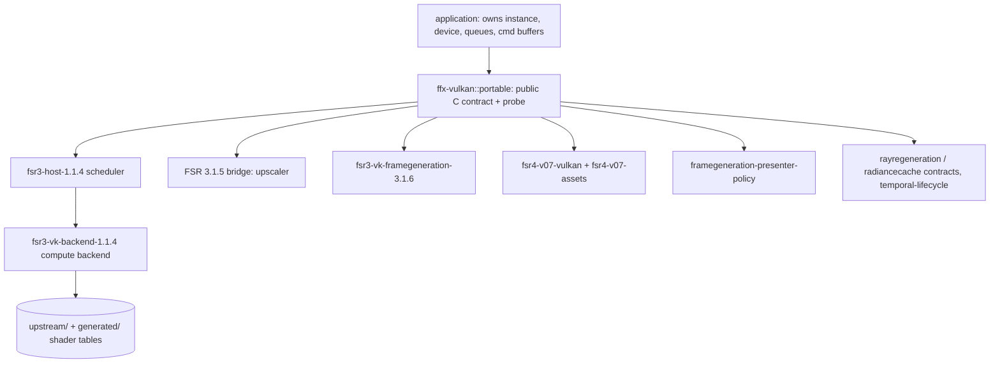

# FSR-Vulkan code map

- **Repo:** iannitram/FSR-Vulkan (public fork). **Kind:** C/C++ library built with CMake: a portable Vulkan port of AMD FidelityFX FSR (upscaling, frame generation, an experimental FSR 4 provider).
- **Upstream:** FireBurn/FSR-Vulkan (`upstream/main`). **Integration branch:** `main`.
- **Describes commit:** `28e5d9a` (2026-10-26).

A reusable module extracted from a Q2RTX integration. The application owns the Vulkan instance, device, queues, command buffers and images; the module owns the FidelityFX contexts and their internal resources and records work into an application-provided command buffer. Its own sources are MIT; vendored AMD sources carry their own MIT notices (see `NOTICE.md`, `UPSTREAM.md`).

## Layout

| Path | What it owns |
|---|---|
| `CMakeLists.txt` | All targets, options (`FFX_VK_PORTABLE_BUILD_*`), install and CMake package export; 38 `add_test` entries |
| `include/` | Public headers: `ffx_vk_portable.h` (core C contract, capability probe types), `ffx_vk_fsr3_3_1_5_*.h` (bridge, bundle, catalog, descriptor, pipeline, reflection), `ffx_vk_fsr4_v07*.h`, `ffx_vk_framegeneration_presenter.h`, `ffx_vk_temporal_lifecycle.h`, `ffx_vk_rayregeneration_contract.h`, `ffx_vk_radiancecache_contract.h`, `ffx_vk_vulkan_compat.h` |
| `src/ffx_vk_portable.c`, `ffx_vk_fsr3_portable.cpp` | Public API implementation and the FSR 3.1.4 host scheduler glue |
| `src/ffx_vk_fsr3_3_1_5_*` | SDK 2.3 FSR 3.1.5 upscaler: bridge, SPIR-V bundle, catalog, descriptor layout, pipelines, reflection |
| `src/ffx_vk_fsr3_3_1_6_framegen*.cpp` | SDK 2.3 FSR 3.1.6 analytical frame generation (optical flow plus interpolation) and its shader blob tables |
| `src/ffx_vk_fsr4_v07*.c` | Experimental source-v07 FSR 4 INT8/DOT4 Vulkan compute provider (`ffxFsr4V07...` exports), asset helper, schedule |
| `src/ffx_vk_framegeneration_presenter.c` | Policy library for a generated-then-real two-acquire present plan; no swapchain ownership |
| `src/ffx_vk_temporal_lifecycle.c`, `..._rayregeneration_contract.c`, `..._radiancecache_contract.c` | Input validators and lifecycle helpers; not denoisers or neural inference |
| `src/ffx_1_1_4_portability.hpp` | Portability shim for the vendored 1.1.4 sources |
| `upstream/ffx-1.1.4/`, `upstream/ffx-2.3.0/` | Vendored AMD FidelityFX SDK subsets with `ORIGINAL_SHA256SUMS` and `CURRENT_SHA256SUMS` provenance files |
| `generated/ffx-1.1.4/vk`, `generated/ffx-2.3.0/vk` | Checked-in generated SPIR-V shader tables with manifests |
| `tools/` | `capability_probe.c` (device probe executable); `generate_*` shell scripts (regenerate SPIR-V), `import_*` shell scripts (pull AMD sources), `package_*` and `prepare_*` Python scripts (bundle SPIR-V, prepare vendored sources) |
| `tests/` | 22 C and C++ test programs, plus CMake scripts for SPIR-V validation, SHA-256 checks and the installed-package consumer; `CMakeLists.txt` registers them as the 38 `add_test` entries |
| `examples/` | `consumer`, `full-stack`, `installed-full-stack` (integration-contract examples built against the module or its installed package) |
| `cmake/ffx-vulkan-config.cmake.in` | Package config for `find_package(ffx-vulkan)` |
| `README.md`, `UPSTREAM.md`, `NOTICE.md`, `PUBLISHING.md`, `LICENSE.txt` | Status and design boundary; provenance and plan; notices; how the standalone tree is published; MIT license |
| `AGENTS.fork.md`, `CHANGELOG.fork.md`, `CLAUDE.md`, `PIPELINE.md`, `docs/code-map.md` | Ours, not upstream's: agent rules, change log, stage record and this map |
| `VP_VULKANINFO_*.json` | A captured Vulkan profile dump for one AMD GPU (reference data) |

## How it fits together



- Target names are `ffx-vulkan::<name>` aliases; `ffx-vulkan::effects` is an interface target that gathers the effect libraries.
- Typical lifecycle for frame generation: `create -> record prepare -> record dispatch -> retire frame -> destroy`; retire only after the application's GPU fence signals.
- The module never carries the FSR 4 model payload; the application supplies one coherent asset set. Without it the suite has 35 tests, with it 36.
- Presentation, queue submission and pacing stay application-owned. The upstream Win32-only swapchain frame-generation callback is deliberately left null.

## Where our work is

`git log upstream/main..HEAD`: four commits. The code changes are the first two (119 added lines in two files); the other two add our own docs files (`docs/code-map.md`, then the stage record, agent rules and change log).

| Commit | Files | Change |
|---|---|---|
| `cc76692` wip: FSR 4 profiling switches | `src/ffx_vk_fsr4_v07.c` (+109), `upstream/ffx-1.1.4/sdk/src/backends/vk/ffx_vk.cpp` (+10) | Opt-in env switches `BB_FSR4_PROFILE` (GPU time per pass via timestamps) and `BB_FSR4_STATS` (pipeline executable statistics; the device must enable `pipelineExecutableInfo`) |
| `0c076be` | merge | Merges the `exp/fsr4-profile-stats-1020` branch into `main` |

Everything else matches upstream. A branch `fix/skip-protected-memory-types` (upstream PR #1) is not present on this fork's remote; only `main` exists there (checked 2026-10-28). `main` is ahead of upstream, so a pure fast-forward of a mirror no longer applies.

## Build and test

Commands as `PUBLISHING.md` states them:

```sh
cmake -S . -B build -DCMAKE_BUILD_TYPE=Release
cmake --build build --parallel
ctest --test-dir build --output-on-failure
```

- Needs CMake 3.15+, a C11 and C++ compiler, and the Vulkan headers/loader (`find_package(Vulkan REQUIRED)`). Shader regeneration additionally needs `glslang-tools`.
- Useful options: `FFX_VK_PORTABLE_BUILD_TESTS`, `_BUILD_PROBE`, `_BUILD_FSR3_HOST`, `_BUILD_FSR3_VK_BACKEND`, `_BUILD_FSR4_V07_VULKAN`, `_INSTALL` (all ON by default), `FFX_VK_PORTABLE_FSR4_V07_TEST_ASSET_DIR` (optional asset bundle for the layout test).
- CI (`.github/workflows/ci.yml`, job `build-and-test`): on every push and pull request, Ubuntu 24.04, installs `cmake g++ libvulkan-dev glslang-tools`, then configure, build, ctest in Release.

## Mac / PC / Linux

- Linux is the covered platform: CI runs only on Ubuntu 24.04. The code is written for non-Windows hosts (opaque context storage is doubled on non-Windows platforms because of the `wchar_t` size difference).
- The CMake file has MSVC branches (`/W4`) and `UNIX AND NOT APPLE` branches, so Windows and Linux are anticipated; there is no Windows CI job.
- macOS is not targeted: Apple is excluded in some branches and there is no CI. A Mac session can read and edit files and may configure the project only if the Vulkan SDK is installed (R04: no check exists for Mac).
- Tests that need a real GPU (backend smoke tests) depend on the runner's Vulkan driver; ordinary tests are validation and contract checks.

## Open-source pieces

| Piece | Where it fits |
|---|---|
| AMD FidelityFX SDK 1.1.4 (MIT) | Vendored under `upstream/ffx-1.1.4`: FSR 3.1.4 host scheduler, upscaler, frame interpolation, optical flow |
| AMD FSR SDK 2.3.0 (per-file MIT notices) | Algorithm reference and vendored files under `upstream/ffx-2.3.0` (FSR 3.1.5 upscaler, 3.1.6 frame generation); check each file's notice; signed DLLs must not be imported |
| Vulkan headers and loader | Required dependency of every target |
| glslang | Shader generation scripts and SPIR-V validation (`glslang-tools` in CI) |
| Q2RTX | The reference integration that vendors the same tree and supplies a presenter reference |
